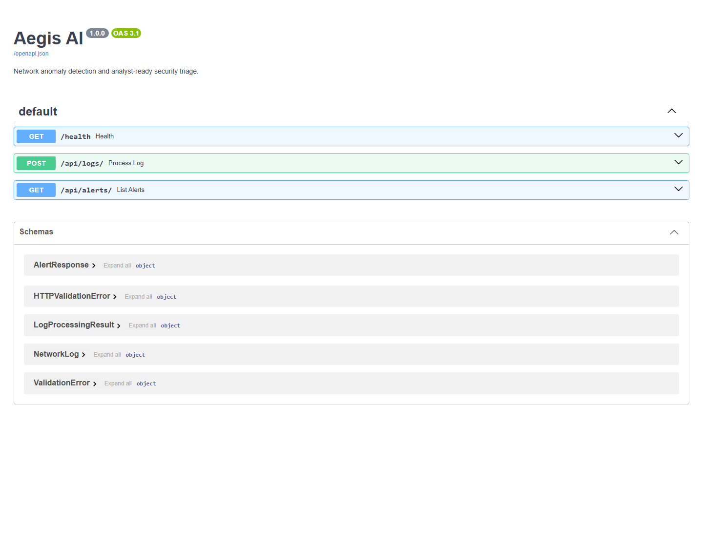
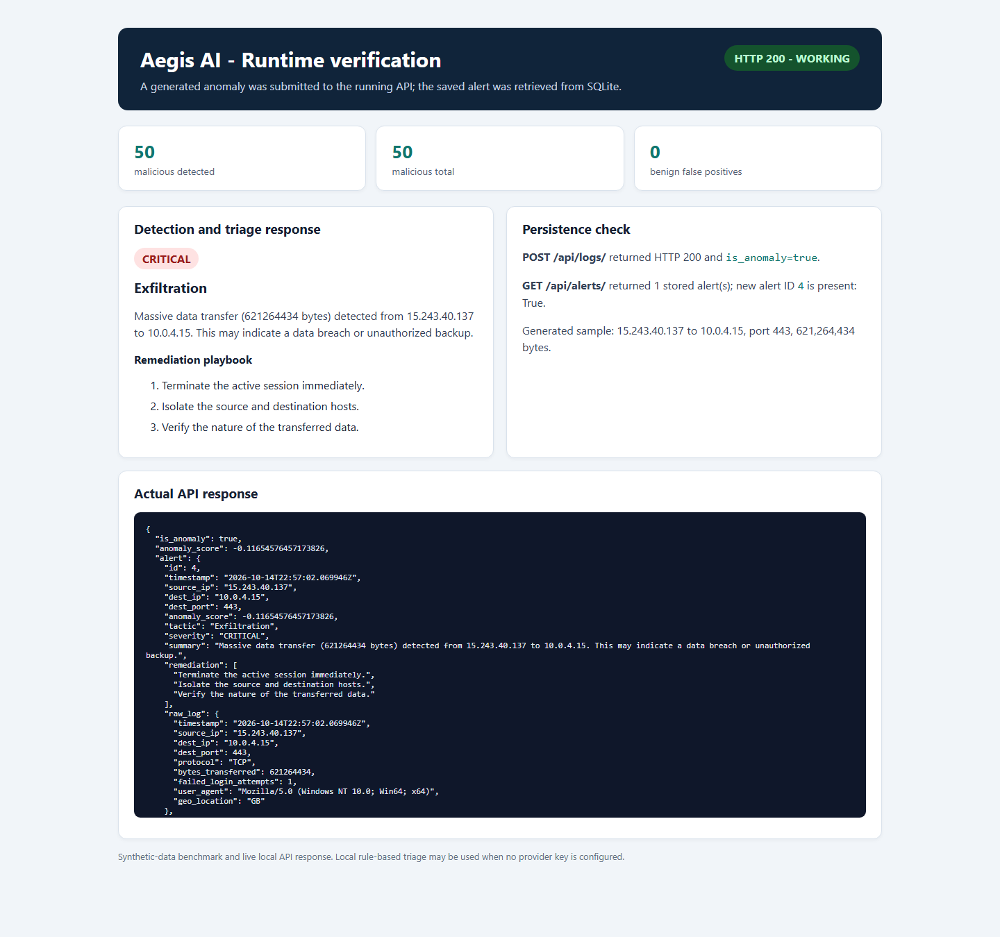

# Aegis AI

Aegis AI is a prototype SOC pipeline that scores network logs with a scikit-learn
Isolation Forest, triages detected anomalies, and stores analyst-ready alerts in
SQLite. The API is implemented with FastAPI.

## Current blueprint status

- **Log generation:** implemented; produces 10,000 benign and 50 malicious sample
  records in `scripts/network_logs.csv`.
- **Anomaly detection:** implemented; trains and saves a preprocessing-plus-
  Isolation-Forest pipeline in `ml_models/`.
- **LLM triage:** implemented with strict JSON validation. When `OPENAI_API_KEY`
  is absent, a deterministic local triage is used for development.
- **Alerts API:** implemented; accepts logs, detects and triages anomalies,
  persists alerts in SQLite, and exposes a filterable alert list.
- **Dashboard UI / human approval:** not included in the supplied blueprint
  repository and remains future work.

## Runtime screenshots

Captured during a local run on the generated synthetic dataset. The runtime
verification image shows the detector benchmark, an actual `POST /api/logs/`
response, and the resulting alert retrieved from SQLite. Triage used the local
development fallback; no external LLM request was made.

**Available API endpoints**



**Anomaly detection, triage, and alert persistence**



## Setup and run

```powershell
python -m venv venv
.\venv\Scripts\Activate.ps1
pip install -r requirements.txt
Copy-Item .env.example .env
python scripts\generate_logs.py
python scripts\train_model.py
uvicorn api.main:app --reload
```

Set `OPENAI_API_KEY` in `.env` to enable provider-backed triage. Without a key,
the local triage keeps the API usable for development and testing.
Set `DJANGO_SECRET_KEY` to a private random value if using the Django scaffold;
the application generates a process-local development key when it is omitted.

## API

- `GET /health` — service health.
- `POST /api/logs/` — validate and score a network log; anomalies are triaged,
  stored, and returned as alerts.
- `GET /api/alerts/` — list stored alerts; supports `severity`, `limit` (1–200),
  and `offset` query parameters.
- `GET /docs` — interactive OpenAPI documentation.

Run the API tests with `python -m unittest api.tests`.
