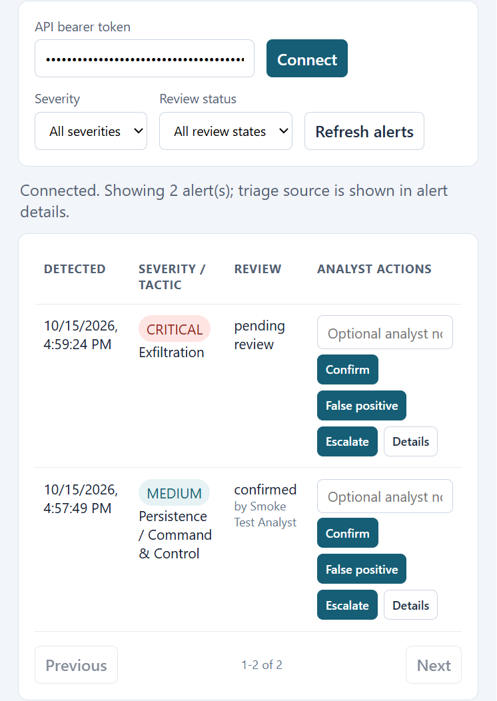

# Aegis AI

Aegis AI is a prototype SOC workflow for generating network telemetry, flagging
outliers, preparing analyst triage, and recording human review. It uses a
scikit-learn Isolation Forest with explicit rule signals, a FastAPI service,
SQLite persistence, and a small analyst console.

## Project status

- **Synthetic data:** generates 10,000 varied benign records and 50 injected
  malicious records. It includes web, DNS, administration, API, and backup
  traffic profiles.
- **Detection:** trains the Isolation Forest on benign data only. A threshold is
  calibrated on a held-out benign validation split; a separate benign-and-attack
  test split reports precision, recall, F1, false-positive rate, ROC-AUC, and
  average precision. A deterministic rule baseline is reported alongside the
  model and hybrid.
- **Triage:** validates the structured LLM response. Provider-backed triage is
  used when `OPENAI_API_KEY` is set; otherwise the response is marked as a local
  fallback. Triage recommendations are advisory; the service never performs
  blocking or isolation actions.
- **Analyst workflow:** browse and filter alerts, inspect raw event details,
  record review outcomes and notes, and inspect the alert audit history.
- **API protections:** bearer-token authentication, request body size limits,
  and per-process/per-IP rate limiting.
- **Automation and packaging:** CI runs generation, training, model evaluation,
  API tests, and Django checks. A non-root Docker image is provided.

## Held-out synthetic evaluation

Run `python -m scripts.generate_logs` and `python -m scripts.train_model` to
reproduce `ml_models/evaluation.json`. The seeded split has 7,000 benign training
rows, 1,500 benign validation rows, and a test set of 1,500 benign plus 50
malicious rows. Labels are not used to fit the Isolation Forest; the threshold
is chosen from validation benign scores.

| Detector | Precision | Recall | F1 | False positives | ROC-AUC |
|---|---:|---:|---:|---:|---:|
| Isolation Forest | 0.70 | 0.42 | 0.53 | 9 | 0.88 |
| Synthetic rule baseline | 1.00 | 1.00 | 1.00 | 0 | — |
| Hybrid | 0.85 | 1.00 | 0.92 | 9 | — |

These figures describe **only this synthetic benchmark**. The rule baseline
recognizes patterns deliberately injected by the generator, so its perfect
score does not establish performance on new attack families. The Isolation
Forest misses attacks on the held-out split; retaining this result makes the
limitation visible instead of reporting training-set accuracy as generalization.
Do not use these numbers to justify production deployment. Validation on
representative, properly labeled, held-out enterprise telemetry is still
required.

## Screenshots





## Local setup

Requires Python 3.12 or newer. In PowerShell:

```powershell
python -m venv venv
.\venv\Scripts\Activate.ps1
pip install -r requirements.txt
Copy-Item .env.example .env
python -c "import secrets; print(secrets.token_urlsafe(48))"
```

Paste the generated random value into `.env` as `AEGIS_API_TOKEN` (at least 32
characters). Do not commit `.env`. To enable OpenAI-backed triage, also set
`OPENAI_API_KEY`; without it, Aegis uses its explicit local development
fallback. Then generate the data, train, test, and start the API:

```powershell
python -m scripts.generate_logs
python -m scripts.train_model
python -m unittest api.tests -v
python manage.py check
uvicorn api.main:app --reload
```

Open `http://127.0.0.1:8000/dashboard`, enter the same bearer token, and connect.
Interactive API documentation is at `http://127.0.0.1:8000/docs`; `/health` is
available without authentication.

## API

All `/api/*` routes require `Authorization: Bearer <AEGIS_API_TOKEN>`.

- `POST /api/logs/` — validate and score a log; triage and persist it if
  anomalous.
- `GET /api/alerts/` — paginated alerts (`limit`, `offset`), filterable by
  `severity` and `review_status`. The response contains `items`, `total`,
  `limit`, and `offset`.
- `PATCH /api/alerts/{id}/review` — set `pending_review`, `confirmed`,
  `false_positive`, or `escalated`, with a reviewer name and optional note.
- `GET /api/alerts/{id}/history` — view creation and analyst-review audit events.
- `GET /dashboard` — analyst console.
- `GET /health` — unauthenticated process health.
- `GET /docs` — OpenAPI documentation.

The reviewer name is self-reported and the API token is shared: this is not
individual analyst identity or enterprise SSO. The in-memory rate limiter is
per process and client IP; use a trusted TLS-terminating proxy, centralized rate
limiting, and individually authenticated users before deploying to a team.

## Docker

Create `.env` and set `AEGIS_API_TOKEN` as described above, then run:

```powershell
docker compose up --build
```

The container runs as a non-root user, exposes port 8000, and persists SQLite
data in a named volume. `docker-compose.yml` requires the token at startup.

## CI

The GitHub Actions workflow regenerates the synthetic dataset, trains and
evaluates the detector, runs the automated tests, and runs the Django
configuration check on pushes and pull requests to `main`.
